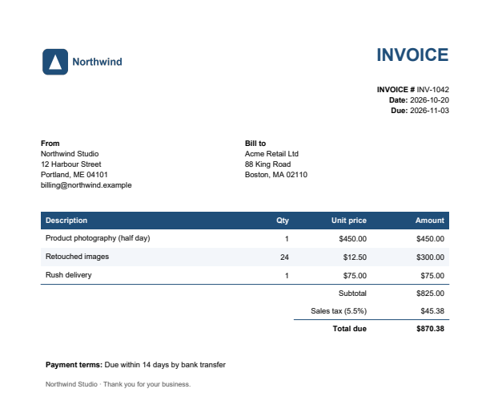
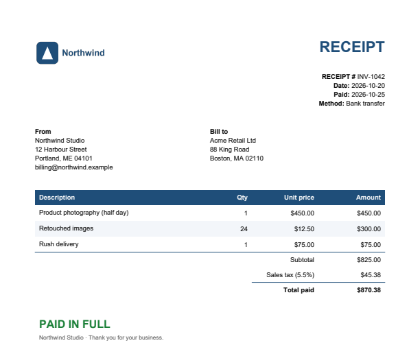
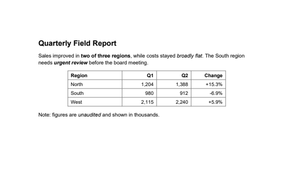

# DocForge

Two small, dependable document tools in one Python package:

1. **`docforge invoice`** — turn a CSV, JSON file or published Google Sheet into **branded invoice and receipt PDFs**.
2. **`docforge extract`** — pull every word out of a text-based PDF into plain text that **keeps the page layout**
   (columns, tables, indentation) and **marks bold and italic** from the actual fonts.

Pure Python, permissive licences only (ReportLab BSD, pdfplumber MIT) — safe to hand over to clients.

## 1. Invoices & receipts

| Invoice | Receipt |
|---|---|
|  |  |

```bash
python -m docforge invoice samples/input/invoices.csv  --brand samples/input/brand.json --out out
python -m docforge invoice samples/input/invoices.json --brand samples/input/brand.json --out out
python -m docforge invoice "https://docs.google.com/spreadsheets/d/<id>/export?format=csv" --brand brand.json
```

**Input** — either flat rows (one line item per row, grouped by `invoice_number`):

```csv
invoice_number,date,due_date,customer,customer_address,description,qty,unit_price,paid_date,payment_method
INV-1042,2026-10-20,2026-11-03,Acme Retail Ltd,"88 King Road
Boston, MA 02110",Product photography (half day),1,450,2026-10-25,Bank transfer
```

…or nested JSON (`[{"invoice_number": ..., "items": [{"description", "qty", "unit_price"}]}]`).

**Branding without touching code** — `brand.json`:

```json
{ "name": "Northwind Studio", "address": "12 Harbour Street\nPortland, ME 04101",
  "logo": "logo.png", "color": "#1f4e79", "currency": "$",
  "tax_label": "Sales tax", "tax_rate": 5.5, "page": "Letter",
  "payment_terms": "Due within 14 days", "footer": "Thank you for your business." }
```

Details that matter on real invoices:
- Money uses `Decimal` with half-up rounding (no floating-point cents errors); `"1,000"` and `"$12.50"` are parsed correctly.
- A receipt is only produced for invoices with a `paid_date` — the tool never issues a "paid" document for an unpaid invoice.
- A4 or US Letter; one PDF per invoice/receipt, named by invoice number.

## 2. Layout-preserving PDF → text

| Source PDF | Extracted text |
|---|---|
|  | see below |

```bash
python -m docforge extract report.pdf                    # -> report.txt, Markdown emphasis
python -m docforge extract report.pdf --emphasis html    # <b> / <i> instead
```

```text
--- Page 1 ---

**Quarterly Field Report**
Sales improved in **two of three regions**, while costs stayed *broadly flat*. The South region
needs ***urgent review*** before the board meeting.

           **Region                     Q1          Q2      Change**
           North                    1,204       1,388     +15.3%
           South                     980         912        -6.9%
           West                     2,115       2,240      +5.9%

Note: figures are *unaudited* and shown in thousands.
```

How it works: every character's position is placed on a fixed character grid, so columns and table cells stay aligned;
touching glyphs are kept together so large headings don't get split. Bold/italic come from the font name of each glyph
(`Helvetica-Bold`, `Times-Italic`, …) — nothing is guessed.

Options: `--emphasis markdown|html|none`, `--no-page-markers`, `--out file.txt`.

## Setup & tests

```bash
python -m venv .venv
.venv\Scripts\activate            # Windows (source .venv/bin/activate on macOS/Linux)
pip install -r requirements.txt
python samples/make_samples.py    # demo inputs
python -m unittest discover tests
```

## Limits

- `extract` needs real text in the PDF; scanned pages would need OCR first.
- PDFs that fake bold by drawing text twice (rather than using a bold font) are not detected as bold.
- Google Sheets input reads a published/shared CSV link; private sheets would need the Sheets API.
